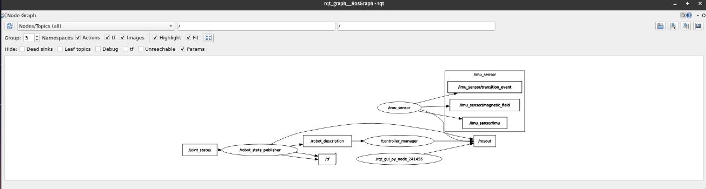

# IMU MAG Sensor Broadcaster

**About:** IMU and magnetometer sensor broadcaster based on the [ros2_controllers](https://github.com/ros-controls/ros2_controllers/blob/humble/imu_sensor_broadcaster/src/imu_sensor_broadcaster.cpp) implementation. Adds the magnetometer state interfaces fields to be published as ROS2 topic messages. Tested on the [LPMS-CU3](https://www.lp-research.com/9-axis-usb-can-rs232-and-ttl-imu-lpms-u3-series/) sensor.


<p align="center">
  rqt_graph view example.
</p>

Pluginlib-Library: imu_mag_sensor_broadcaster

Plugin: imu_sensor_broadcaster/IMUSensorBroadcaster (controller_interface::ControllerInterface)

## How to use

Compile with `colcon build --symlink-install`.

Setup the config.yaml for the controller manager with the imu_mag interface, e.g.:

```yaml
imu_sensor:
  ros__parameters:
    type: "imu_mag_sensor_broadcaster/ImuMagSensorBroadcaster"
    sensor_name: "imu_sensor"
    frame_id: "imu_sensor_link"
    static_covariance_orientation: [0.0, 0.0, 0.0, 0.0, 0.0, 0.0, 0.0, 0.0, 0.0]
    static_covariance_angular_velocity: [0.0, 0.0, 0.0, 0.0, 0.0, 0.0, 0.0, 0.0, 0.0]
    static_covariance_linear_acceleration: [0.0, 0.0, 0.0, 0.0, 0.0, 0.0, 0.0, 0.0, 0.0]
    magnetometer_sensor_name: "mag_sensor"
    magnetometer_frame_id: "magno_sensor_link"
    static_covariance_magnetic_field: [0.0, 0.0, 0.0, 0.0, 0.0, 0.0, 0.0, 0.0, 0.0]

```
<p align="center">
  imu_mag_sensor_broadcaster_config.yaml
</p>

Execute the sensor hardware interface, then the [controller_manager](https://github.com/ros-controls/ros2_control/tree/master/controller_manager) with this custom broadcaster, e.g.:

```xml
<launch>
    <arg name="config_sensor" default="$(find-pkg-share my_robot_bringup)/config/imu_mag_sensor_broadcaster_config.yaml" />

    <node name="imu_mag_sensor_broadcaster" pkg="controller_manager" exec="spawner" args="-p $(var config_sensor) --controller-manager-timeout 90 imu_sensor"  />

</launch>
```
<p align="center">
  imu_mag_broadcaster.launch.xml
</p>

